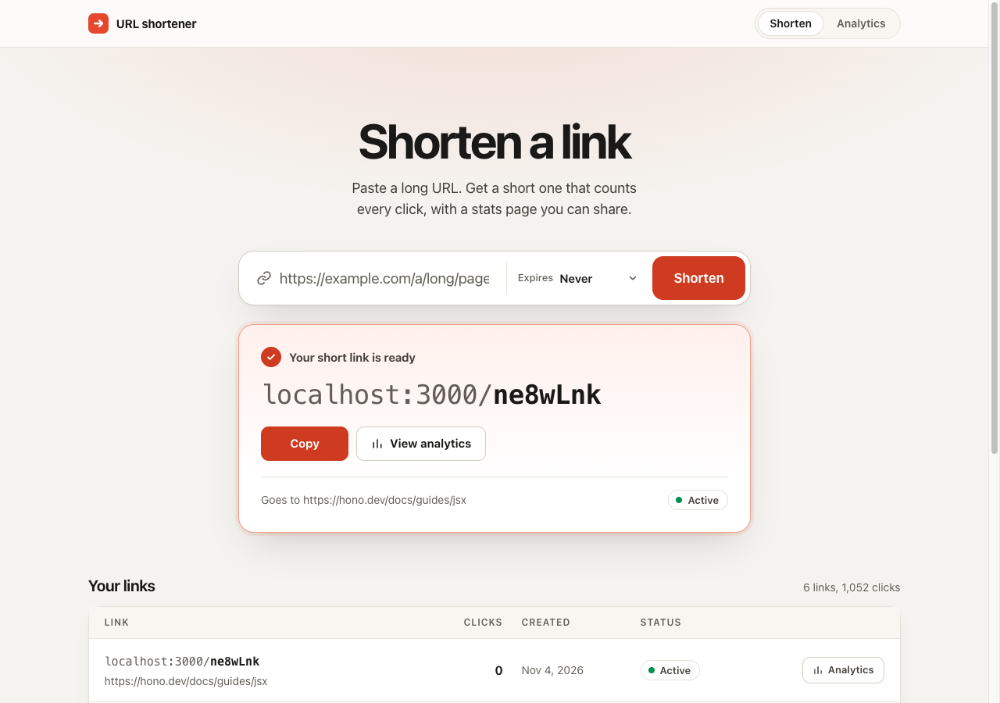
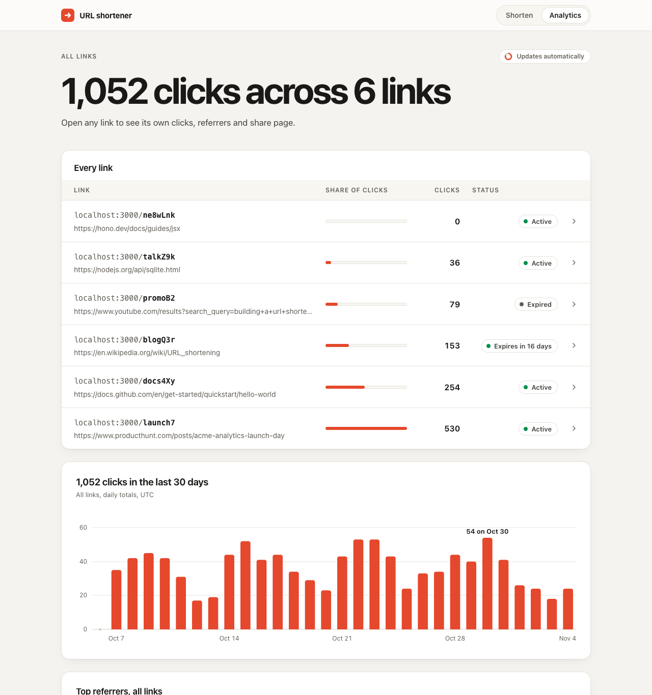
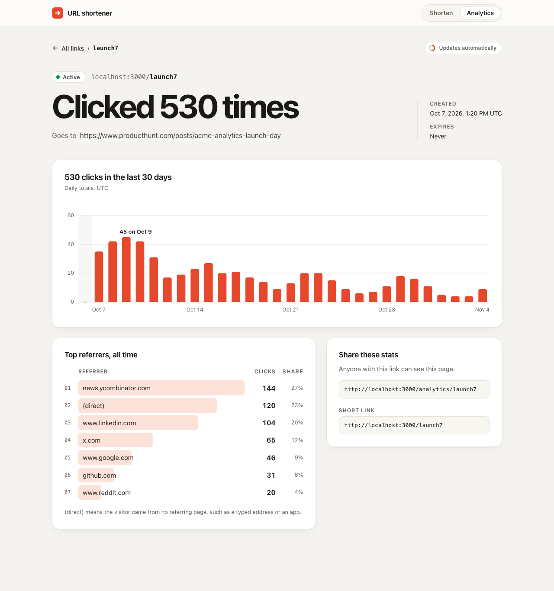
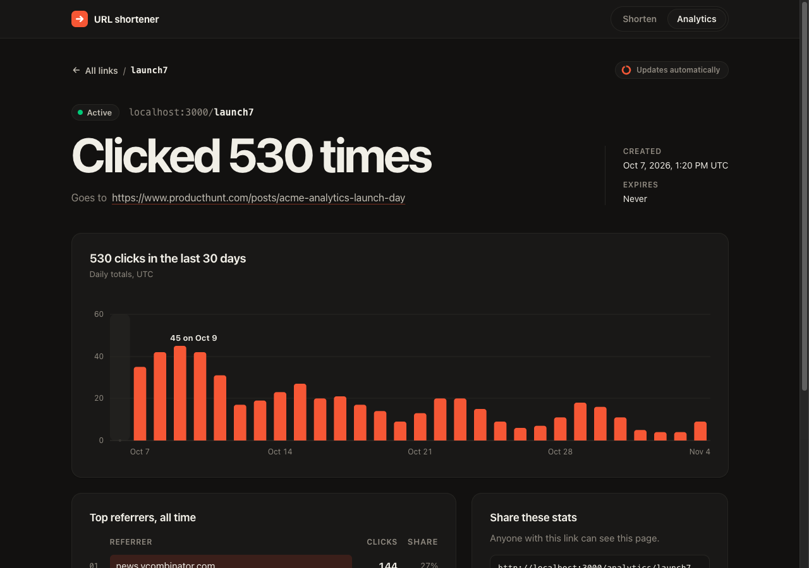
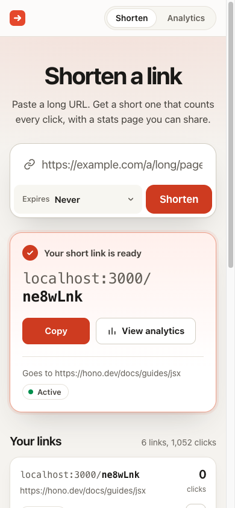

# URL shortener

Shorten a link, share it, and see who clicks it. A small full-stack service with click tracking, per-link and all-links analytics, and optional expiry.



## Quick start

Requires Node 24 or later (tested on 25.9).

```sh
npm install
npm run dev    # http://localhost:3000
npm test
```

The SQLite database and its tables are created automatically at `./data/urlshortener.db`.

## Using it

| Page               | What it's for                                              |
| ------------------ | ---------------------------------------------------------- |
| `/`                | Paste a link, choose an expiry, and get a short link       |
| `/analytics`       | Clicks and referrers across every link, plus the full list |
| `/analytics/:code` | One link's own data, shareable with whoever created it     |

Analytics pages reload every 5 seconds, so a click in another tab shows up while you watch.

### Analytics across every link

Totals, each link's share of clicks, and 30 days of activity. Every row opens that link's own page.



### One link's own data

Total clicks, a 30-day chart, top referrers, and a link to share.



### Dark mode and phone

| Dark mode, from the system setting                             | Phone                                                                                   |
| -------------------------------------------------------------- | --------------------------------------------------------------------------------------- |
|  |  |

These are real screenshots of the running app. The links and clicks are sample data.

## API

```sh
curl -s http://localhost:3000/api/shorten \
  -H 'content-type: application/json' \
  -d '{"url":"https://example.com","expiresAt":"2030-01-01T00:00:00Z"}'
```

```json
{
  "shortCode": "pQ8wrWB",
  "shortUrl": "http://localhost:3000/pQ8wrWB",
  "analyticsUrl": "http://localhost:3000/analytics/pQ8wrWB",
  "originalUrl": "https://example.com",
  "createdAt": "2026-11-04T13:45:47.125Z",
  "expiresAt": "2030-01-01T00:00:00.000Z"
}
```

| Method     | Path                  | Result                                                                        |
| ---------- | --------------------- | ----------------------------------------------------------------------------- |
| POST       | `/api/shorten`        | `{url, expiresAt?}` returns `201`; invalid input `400`; body over 64 KB `413` |
| GET / HEAD | `/:code`              | Active `301`; unknown `404`; expired `410`. HEAD never records a click        |
| GET        | `/api/urls?limit=100` | `{urls: [...]}` with `totalClicks`, newest first; limit 1 to 500              |
| GET        | `/api/stats/:code`    | `totalClicks`, `clicksByDay` (30 UTC days, zero-filled), `topReferrers`       |

Codes are seven case-sensitive alphanumeric characters. API errors are `{"error":"message"}`.

| Variable        | Default                  | Purpose                                                                   |
| --------------- | ------------------------ | ------------------------------------------------------------------------- |
| `PORT`          | `3000`                   | Listening port                                                            |
| `BASE_URL`      | `http://localhost:$PORT` | Origin for generated links, instead of the client-controlled Host header  |
| `DATABASE_PATH` | `./data/urlshortener.db` | SQLite file path                                                          |
| `TRUST_PROXY`   | off                      | `true` reads the rightmost `X-Forwarded-For`; only behind a trusted proxy |

## Why this stack

- **TypeScript and Hono:** one small process serves JSON, HTML and the root `/:code` redirect, with no framework to fight over a root catch-all route. `app.request()` also makes HTTP tests fast.
- **SQLite through `node:sqlite`:** real persistence and `GROUP BY` for stats, built into Node, so install has no native build to fail. It survives restarts and needs no service. The trade-off is one node and one writer; more scale would mean Postgres behind the same query layer.
- **`hono/jsx` and inline SVG:** auto-escaped server rendering with no chart library or front-end build. The only client script is the dashboard's copy button, and the page works without it.
- **Vitest:** tests run real HTTP handling against real in-memory SQLite, with no mocks.

## Decisions worth knowing

- **301 with `Cache-Control: no-store`.** Browsers cache 301s, which would lose repeat clicks and hide the `410` after expiry. `curl`-based tests can't see this because `curl` doesn't cache. In a real browser, this app counted 5 of 5 navigations, while a control server without `no-store` counted 1 of 5.
- **What counts as a click.** Only `GET` requests that redirect. `HEAD`, `404` and `410` don't count. Bots and link previews do count; filtering them is out of scope. A failed click write is logged and the redirect still happens.
- **Expiry.** `expiresAt` must be a real RFC 3339 timestamp with a timezone, and in the future; a past value returns `400`. The dashboard offers presets instead, including 1 minute, because a browser date picker has no timezone.
- **Privacy.** Analytics are public to anyone with the code, so no page or API ever returns an IP or user-agent. Both are stored because the brief requires it. Raw IPs are personal data under LGPD, so production use would need a retention policy or hashing, which isn't implemented here.

Full contract and reasoning: [`DECISIONS.md`](DECISIONS.md).

## Out of scope

Authentication, rate limiting, bot and link-preview filtering, custom aliases, redirect-loop detection, and deployment.

## How this was built

Built live with AI agents during a one-hour interview, with a human directing and reviewing. The commit history shows the order:

1. **Contract first.** `DECISIONS.md` fixed the API, schema and file ownership before any application code.
2. **Parallel streams.** After a sequential foundation, agents worked in separate git worktrees, each owning its own files.
3. **Black-box tests.** One agent wrote tests from the contract without reading the implementation.
4. **Checking the tests.** An agent injected 44 realistic bugs one at a time, and the suite caught 41. The 3 misses were test gaps, not bugs in the code.
5. **Adversarial review.** Fresh-context reviewers checked spec compliance and correctness. A security review was stopped early by a model safeguard, after finding the missing request size limit, which is now fixed. Its other planned checks weren't completed.
6. **Real browser checks.** The 301 caching, expiry and script-injection behavior were all verified in a browser.
